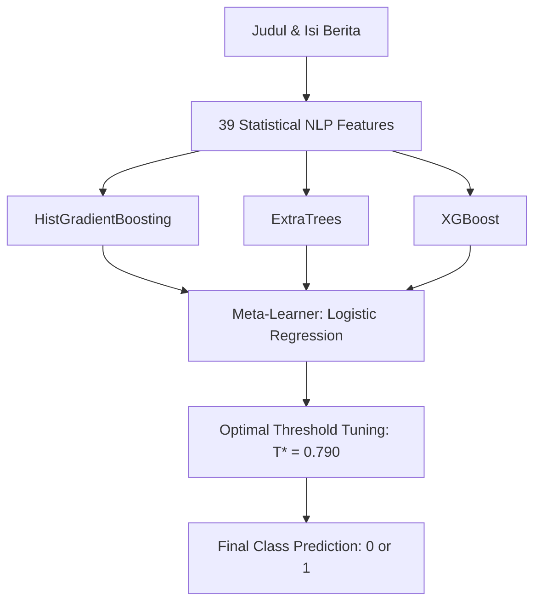

# 📰 News Title-Content Incongruence Detection (IFest DAC)

[](https://www.python.org/downloads/)
[](https://scikit-learn.org/)
[](https://xgboost.readthedocs.io/)
[]()
[](https://opensource.org/licenses/MIT)

Repository ini berisi solusi Machine Learning berbasis **Feature Engineering NLP Statistik Non-Pretrained** dan **Stacking Ensemble** untuk mendeteksi ketidaksesuaian (*incongruence / clickbait*) antara judul dan isi berita berbahasa Indonesia pada kompetisi **IFest Data Analysis Competition (DAC)**.

Solusi ini mematuhi secara penuh seluruh regulasi resmi kompetisi:
- **Rule #4**: *No Pretrained Models* (tanpa IndoBERT, fastText, word2vec, atau checkpoint model eksternal).
- **Rule #5**: *No Generative AI / LLM APIs* (tanpa prompting ChatGPT, Claude, Gemini, dll.).
- **Rule #8**: *No Data Leakage* (fitur statistik seperti TF-IDF dan SVD di-fit secara ketat hanya pada fold latih di dalam Cross Validation).
- **Rule #11**: *Deterministic & Reproducible* (`RANDOM_STATE = 42`).

---

## 📌 Problem Statement
Membangun model klasifikasi biner untuk memverifikasi apakah isi berita mendukung judulnya:
- **Label 1 (Sesuai / Congruent)**: Informasi utama pada judul dibahas dan didukung secara substantif oleh isi berita.
- **Label 0 (Tidak Sesuai / Incongruent / Clickbait)**: Isi berita tidak mendukung judul, mengaburkan fakta, atau membahas entitas/konteks yang bertolak belakang.
- **Metrik Evaluasi**: **Macro F1-Score** $\left(\frac{F_{1,\text{class 0}} + F_{1,\text{class 1}}}{2}\right)$.
- **Tantangan Utama**: Ketimpangan kelas ekstrem (*class imbalance* ~90% Label 1 vs ~10% Label 0) dan adanya fenomena *silent clickbait* (51.8% berita berlabel 0 memiliki *lexical overlap* tinggi ~77% namun memiliki pergeseran konteks/relasi makna laten).

---

## 🧠 Metodologi & Arsitektur Fitur

Model menggunakan **39 fitur terpilih** yang dirancang secara sistematis setelah mengeliminasi redundansi kolinearitas ($r > 0.85$):

### 1. Latent Semantic Analysis (LSA / TruncatedSVD)
- Mengekstraksi 50 komponen semantik laten dari matriks TF-IDF unigram-bigram yang dilatih *from scratch* pada fold latih tanpa *leakage*.
- Menghasilkan representasi vektor densitas rendah untuk mengukur kedekatan topik judul vs isi (`cos_lsa_c`) serta judul vs kalimat pembuka (`cos_lsa_fs`), mengatasi *silent clickbait* yang lolos dari pencocokan kata leksikal.

### 2. Discourse Segmentation & Sentence Spread
- **IDF-Weighted Best Window**: Menemukan jendela paragraf isi yang paling relevan dengan judul menggunakan pembobotan kata kunci langka (`best_win_tfidf_cos`).
- **Discourse Spread**: Mengukur persebaran informasi judul di seluruh teks:
  - Cakupan kalimat pembuka (*lead coverage*).
  - Cakupan maksimum pada kalimat tunggal (*max single-sentence coverage*).
  - Rasio sebaran kalimat pendukung (*spread ratio* dan *needed sentences*).

### 3. Canonical Entity Linking & Robust Parsing
- **Kamus Kanonikal Indonesia**: Menormalisasi alias lokasi dan tokoh penting nasional (misal: *Jateng* $\leftrightarrow$ *Jawa Tengah*, *Jokowi* $\leftrightarrow$ *Joko Widodo*) guna mencegah *false mismatch* pada berita valid.
- **Generic Entity N-grams**: Mendeteksi entitas baru/tak terdaftar berbasis kapitalisasi dan frekuensi untuk mencegah *domain shift*.
- **Comprehensive Numerical & Currency Parser**: Mengekstrak bilangan bulat, desimal, persentase, serta satuan mata uang dan tanggal bahasa Indonesia dengan toleransi perbedaan notasi (*fuzziness*).

### 4. Semantic Polarity & Antonym Pairs
- Kamus 38 pasang antonim jurnalistik Indonesia (misal: *naik* vs *turun*, *menang* vs *kalah*, *ditangkap* vs *dibebaskan*) untuk mendeteksi kontradiksi faktual antara judul dan isi.

---

## 🏗️ Stacking Ensemble Architecture

Pipeline model menggunakan arsitektur Stacking bertingkat (*two-stage ensemble*) dengan validasi 5-Fold Stratified Cross-Validation:



1. **Level-0 Base Learners**:
   - `HistGradientBoostingClassifier` (robust terhadap fitur numerik berdistribusi miring).
   - `ExtraTreesClassifier` (meningkatkan generalisasi via *randomized splits*).
   - `XGBClassifier` (mengoptimalkan penalti regularisasi dan bobot ketidakseimbangan).
2. **Level-1 Meta-Learner**:
   - `LogisticRegression` yang mengombinasikan probabilitas *out-of-fold* dari ketiga base model secara terkalibrasi.
3. **Threshold Optimization**:
   - Penyesuaian ambang probabilitas optimal ($T^* = 0.790$) untuk memaksimalkan Macro F1 pada evaluasi out-of-fold.

---

## 📊 Hasil Evaluasi (5-Fold Stratified Cross Validation)

Evaluasi dilakukan pada seluruh data latih (14.397 sampel) secara *out-of-fold* tanpa kebocoran data:

| Metric | Nilai | Keterangan |
| :--- | :---: | :--- |
| **Precision (Kelas 0 - Incongruent)** | **60.38%** | Ketepatan deteksi berita tidak sesuai |
| **Recall (Kelas 0 - Incongruent)** | **35.84%** | Sensitivitas menangkap clickbait laten |
| **F1-Score (Kelas 0)** | **0.4500** | Keseimbangan deteksi kelas minoritas |
| **Precision (Kelas 1 - Congruent)** | **93.41%** | Keandalan validasi berita sesuai |
| **Recall (Kelas 1 - Congruent)** | **97.41%** | Menjaga artikel asli tidak salah dikira clickbait |
| **F1-Score (Kelas 1)** | **0.9537** | F1 kelas mayoritas |
| **Overall Accuracy** | **91.25%** | Akurasi klasifikasi keseluruhan |
| **Macro F1-Score** | **0.7011** | **Metrik Resmi Kompetisi** |

---

## 📂 Struktur File

```text
├── IFest.ipynb              # Notebook implementasi end-to-end (EDA, Fitur, 5-Fold Stacking CV, Export)
├── train.csv                # Dataset latih resmi (14.397 baris)
├── test.csv                 # Dataset uji resmi (3.603 baris)
├── sample_submission.csv    # Template format pengumpulan
├── submission_baseline.csv  # File prediksi data uji (3.603 prediksi terverifikasi)
├── requirements.txt         # Dependensi Python lingkungan eksekusi
├── .gitignore               # Pengabaian direktori cache, checkpoint, dan temp
└── README.md                # Dokumentasi teknis & metodologi proyek
```

---

## 🚀 Cara Menjalankan (Quickstart)

### 1. Persiapan Lingkungan
Pastikan menggunakan Python 3.10 atau versi yang lebih baru:
```bash
pip install -r requirements.txt
```

### 2. Menjalankan Notebook
Jalankan notebook `IFest.ipynb` secara berurutan:
- **Cell 1–3**: Pemuatan data & modul NLP.
- **Cell 4**: Ekstraksi 39 fitur statistik, LSA TruncatedSVD, dan wacana teks.
- **Cell 5–7**: Pelatihan 5-Fold Stratified Cross-Validation Stacking Ensemble & tuning threshold ($T^* = 0.790$).
- **Cell 8–9**: Ekstraksi data uji dan ekspor file inferensi `submission_baseline.csv`.

Hasil prediksi final akan tersimpan di `submission_baseline.csv` dengan format kolom `id` dan `label` yang teruji 100% valid dan lengkap.
